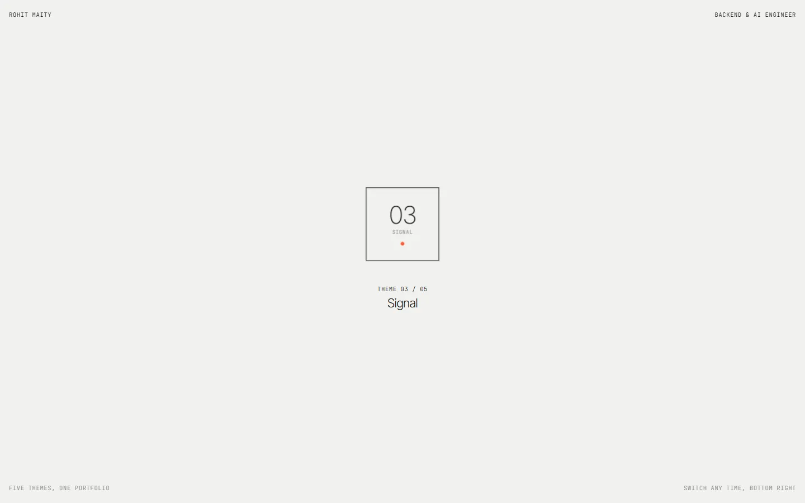
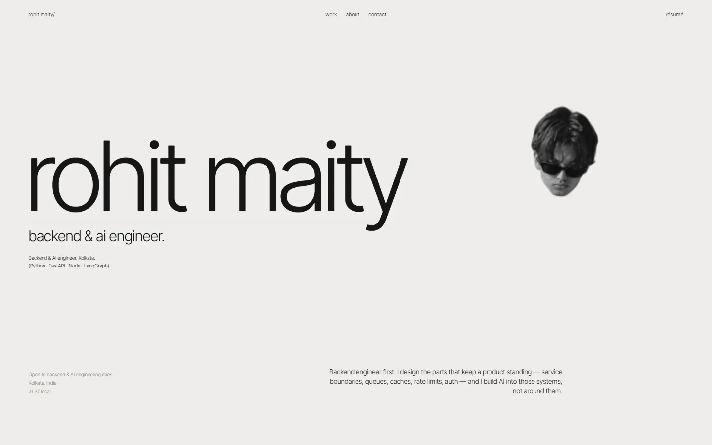
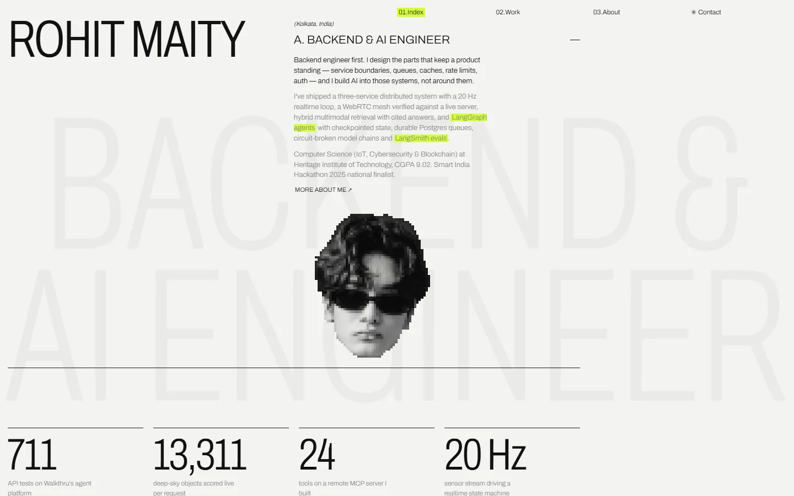
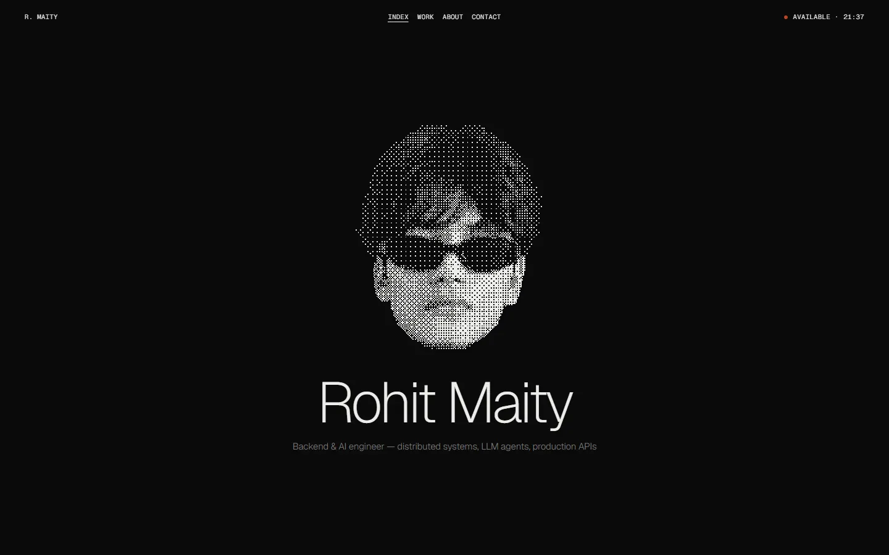
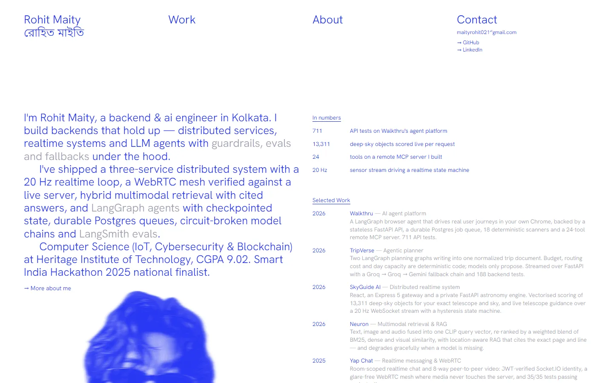
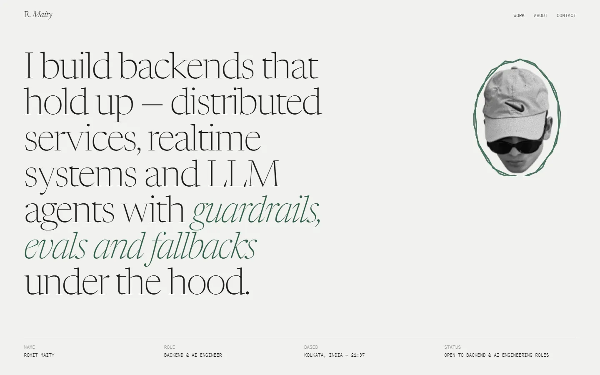
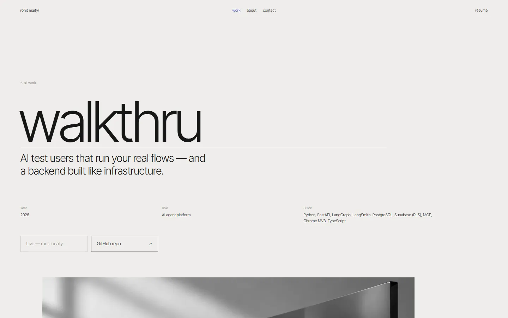

# Rohit Maity — Portfolio

A quiet, text-led portfolio. It's where I present my work to myself and to anyone hiring: the projects I've built, the engineering behind them, what I write, a little about me, and what I'm going deep on right now.

I'm a backend & AI engineer (Python, FastAPI, Node.js, LangGraph). The site is deliberately minimal so the work does the talking: light type, greys plus one accent colour, a few images, and subtle motion.



## Five themes, one portfolio

The same content is presented in five different designs. On each visit a die rolls and picks one at random. A switcher in the bottom-right corner of every page lets you move between them.

| | |
|---|---|
|  |  |
| **01 · Paper**: Swiss, lowercase, hairlines | **02 · Ledger**: condensed type, project ledger |
|  |  |
| **03 · Signal**: dark, centred, one orange accent | **04 · Blueprint**: an all-blue CV layout |
|  |  |
| **05 · Dial**: serif and editorial | **Case pages**: the engineering behind each project |

## What's inside

- **Work:** case studies of my projects (Walkthru, TripVerse, SkyGuide AI, Neuron, Yap Chat, Shiori, Forcaster). They cover the architecture, the hard problems and how they were solved, each with live and GitHub links.
- **Writing:** my articles on Hashnode.
- **About:** who I am, how I work, and what I'm currently going deep on.
- **Contact:** email, socials, résumé and a message form.

## Built with

Vite · vanilla JavaScript · GSAP · Lenis. No framework, no backend: every page is a static file.

## Editing

Everything is driven from three places, so changing the site rarely means touching a page:

| Change | Where |
|---|---|
| Any text: hero, projects, about, writing, contact | `src/config/content.js` |
| Colours, fonts, portrait and its filter per theme | `src/config/theme.js` |
| Images and the résumé | `site-assets/` (folders are picked up automatically, in filename order) |

All five themes use the same profile photo from `site-assets/portraits/profile.png`. Replace that file to update the portrait everywhere; each theme keeps its own portrait size and visual treatment from `src/config/theme.js`.

## Run it

```bash
npm install
npm run dev      # http://localhost:5173
npm run build    # static site in dist/
```

Deploys to Vercel as a Vite project, with no configuration and no environment variables.

---

© 2026 Rohit Maity · [GitHub](https://github.com/watermelon588) · [LinkedIn](https://www.linkedin.com/in/maity-rohit) · maityrohit021@gmail.com
