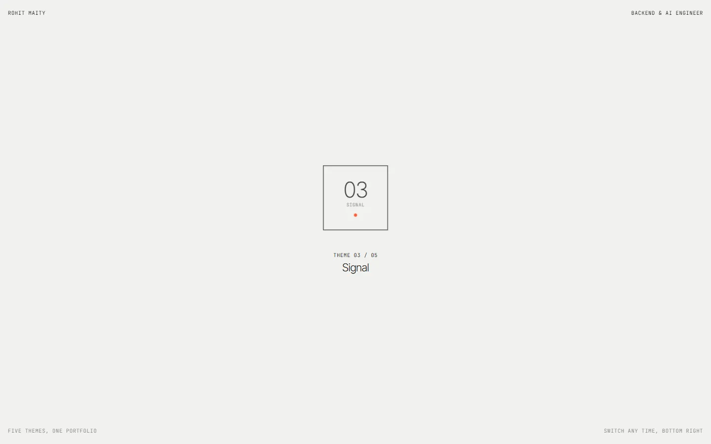
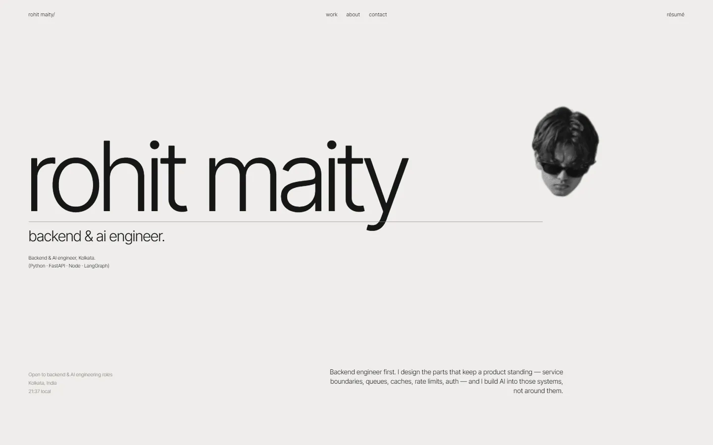
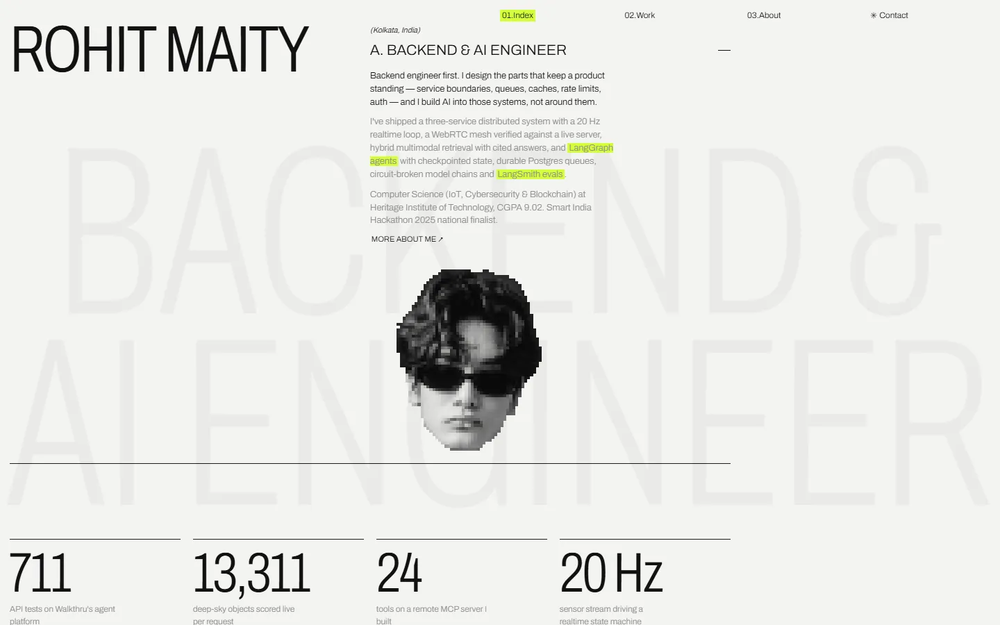
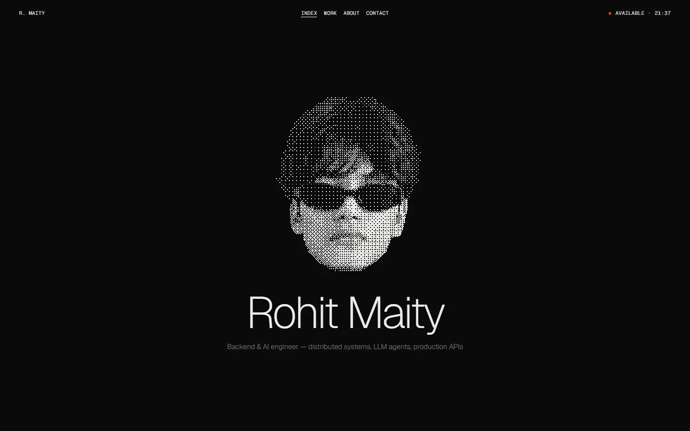
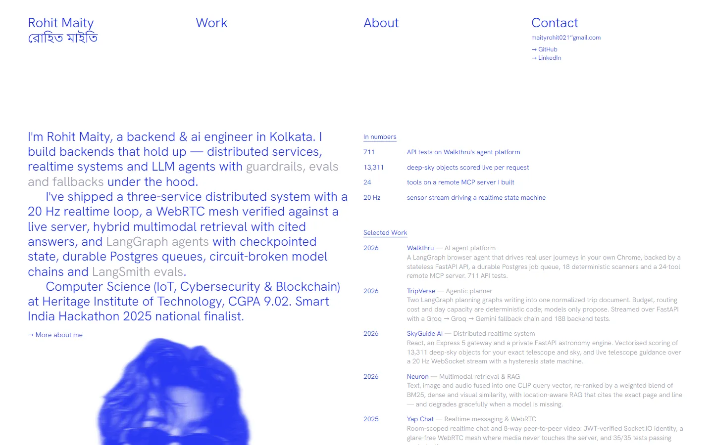
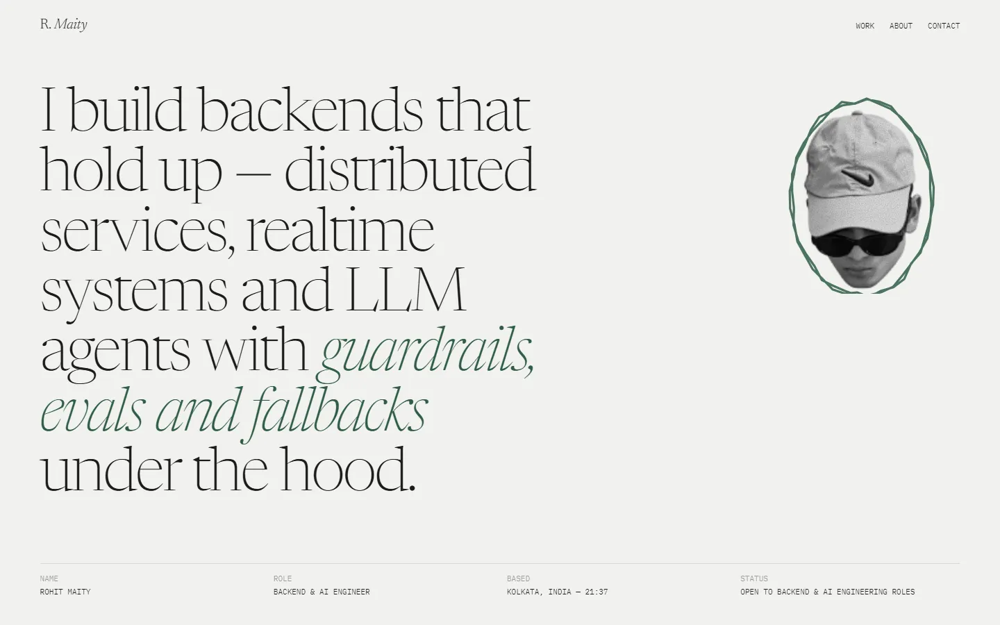
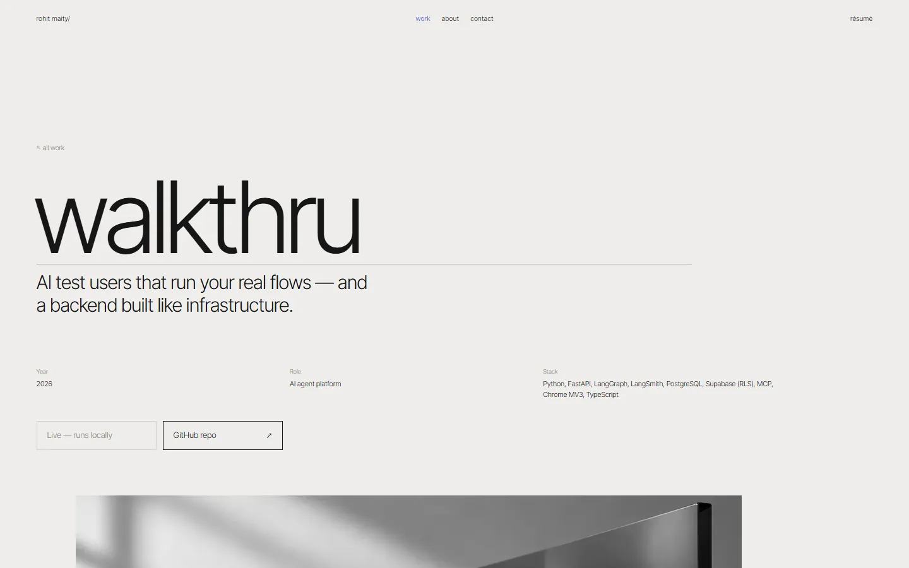

# Rohit Maity — Portfolio

A quiet, text-led portfolio. It's where I present my work to myself and to anyone hiring: the projects I've built, the engineering behind them, what I write, a little about me, and what I'm going deep on right now.

I'm a backend & AI engineer (Python, FastAPI, Node.js, LangGraph). The site is deliberately minimal so the work does the talking: light type, greys plus one accent colour, a few images, and subtle motion.



## Five themes, one portfolio

The same content is presented in five different designs. On each visit a die rolls and picks one at random. A switcher in the bottom-right corner of every page lets you move between them.

| | |
|---|---|
|  |  |
| **01 · Paper**: Swiss, lowercase, hairlines | **02 · Ledger**: condensed type, project ledger |
|  |  |
| **03 · Signal**: dark, centred, one orange accent | **04 · Blueprint**: an all-blue CV layout |
|  |  |
| **05 · Dial**: serif and editorial | **Case pages**: the engineering behind each project |

## What's inside

- **Featured work:** Walkthru, TripVerse, SkyGuide AI, Neuron and Claimwise appear on each homepage, with a link to the complete collection.
- **Projects:** a dedicated, filterable catalog in all five themes. It includes the featured projects, plus Yap Chat, Scribb, KOE, Shiori and Forcaster. Categories cover AI, ML & search, Full-stack and Backend. Every project has an engineering case study, repository links and live links where available.
- **Writing:** my articles on Hashnode.
- **About:** who I am, how I work, and what I'm currently going deep on.
- **Contact:** email, socials, résumé and a message form.

## Built with

Vite · vanilla JavaScript · GSAP · Lenis. No framework, no backend: every page is a static file.

## Editing

Everything is driven from three places, so changing the site rarely means touching a page:

| Change | Where |
|---|---|
| Any text: hero, projects, about, writing, contact | `src/config/content.js` |
| Colours, fonts, portrait and its filter per theme | `src/config/theme.js` |
| Images and the résumé | `site-assets/` (folders are picked up automatically, in filename order) |

All five themes use the same profile photo from `site-assets/portraits/profile.png`. Replace that file to update the portrait everywhere; each theme keeps its own portrait size and visual treatment from `src/config/theme.js`.

Browser and Apple touch icons use clear, unfiltered exports of that same profile photo in `public/favicon-*.png`, `public/favicon.ico` and `public/apple-touch-icon.png`. The original-resolution public copy is `public/profile-share.png`; `public/portfolio-share.png` centers it on a 1200 × 630 share card. Regenerate these exports when the profile image changes. Favicon URLs include a version query to refresh the previous monogram.

Open Graph and X card metadata are emitted into every page's HTML by `vite.config.js`, so link-preview crawlers do not need JavaScript. Edit `src/config/site.js` for the public production origin, title and share-image URL. The production origin is `https://portfolio2-mu-inky.vercel.app`; update it when moving domains. `public/robots.txt` allows the public pages and Twitterbot. Shared case-study URLs use the portfolio profile image; their detailed content still loads in the browser.

Projects live at `/<theme>/projects.html`; case studies remain at `/<theme>/work.html?p=<slug>`. Catalog filters use `?category=ai`, `ml`, `development` or `backend`, survive refresh/back navigation and follow theme switching. Case pages include a category filter and project chooser.

To add a project, create a record in `content.work` with a unique `slug`, `sections`, `categories` and links, then add a shared thumbnail in `site-assets/thumbnails/<slug>.webp` and case images under each `site-assets/variants/<theme>/<slug>/`. Categories may overlap. New entries automatically join the catalog, filter counts, case chooser and next-project chain. The homepage selects the first five records in the array; reorder that array to change featured work.

## Run it

```bash
npm install
npm run dev      # http://localhost:5173
npm run build    # static site in dist/
```

Deploys to Vercel as a Vite project, with no configuration and no environment variables.

---

© 2026 Rohit Maity · [GitHub](https://github.com/watermelon588) · [LinkedIn](https://www.linkedin.com/in/maity-rohit) · maityrohit021@gmail.com
